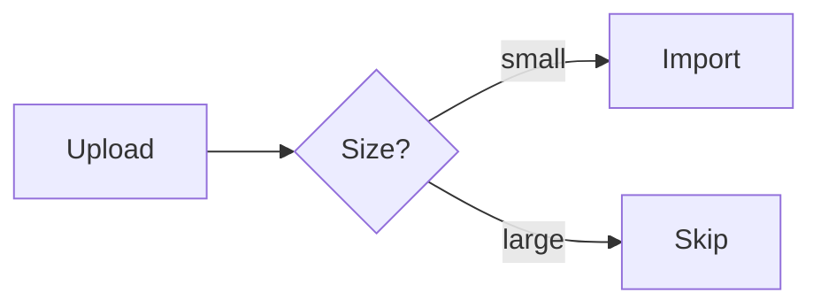

# Import pipeline refactor

## Context

The importer is slow and runs out of memory on large uploads.

## Import pipeline

How a file moves from upload to notification.

```trace
lanes: [business, code]
nodes:
  - {id: B1, lane: business, text: Receive uploaded files, next: [B2]}
  - {id: B2, lane: business, text: Extract text, next: [B3]}
  - {id: B3, lane: business, text: Classify the document, next: [B4]}
  - {id: B4, lane: business, text: Notify the user}

  - {id: C1, lane: code, text: Upload endpoint handlers, realizes: [B1],
     ref: "gh:src/upload/handlers.py#L40-L120", next: [C2]}
  - {id: C2, lane: code, text: Skip files larger than 20 MB,
     ref: "gh:src/import/size_guard.py#L12-L48", next: [C3],
     why: the parser runs out of memory on larger files}
  - {id: C3, lane: code, text: Extract and classify in one pass,
     realizes: [B2, B3], ref: "gh:src/import/parse.py#L200-L310", next: [C4],
     why: avoids parsing each file twice}
  - {id: C4, lane: code, text: Batch and rate-limit per user,
     realizes: [B4], ref: "gh:src/notify/batch.py#L15-L90"}
```

## Retries

```trace
lanes: [business, service, code]
nodes:
  - {id: R1, lane: business, text: Retry failed imports, next: [{to: R2, label: gave up}]}
  - {id: R2, lane: business, text: Tell support}
  - {id: S1, lane: service, text: Retry queue, realizes: [R1], next: [S2]}
  - {id: S2, lane: service, text: Dead-letter queue, realizes: [R2]}
  - {id: K1, lane: code, text: Exponential backoff worker, realizes: [S1], ref: "gh:src/retry/worker.py#L1-L80", next: [K2]}
  - {id: K2, lane: code, text: Alert on DLQ depth, realizes: [S2, R2], next: [K3]}
  - {id: K3, lane: code, text: Purge after 7 days, why: storage quota}
```

## Sketch

Mermaid blocks are free-form sketches; kalka draws them and attaches no meaning to them.



## Rollout

Behind a flag.
