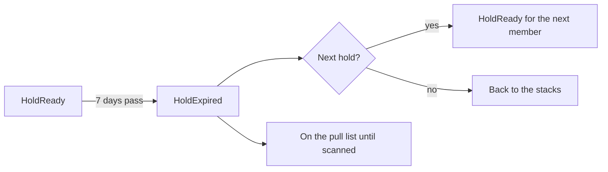

# Hold shelf expiry

## Context

Items wait on the hold shelf for 7 days. Today staff walk the shelf every morning and pull expired items by hand, comparing slips with a printed list. On busy weeks the walk takes an hour, and items sit on the shelf for days after expiry while the next member in the queue waits.

This plan expires holds automatically, moves the item to the next hold or back to the stacks, and tells staff which items to pull.

## Scope

Touches the `holds` module, the `HoldReady` and `HoldExpired` events, and the staff pull list in the desk app.

Does not change how members place holds, the notices members get (owned by the Notices context), or the catalogue.

## Plan

1. A nightly job finds holds whose pickup window ended before today, at each branch's local midnight.
2. For each, it emits `HoldExpired` and either readies the next hold on the title, or releases the item to the stacks.
3. The desk app shows a **pull list**: items to take off the shelf, and where each goes next.
4. Staff scan an item to confirm the pull; until then the item stays reserved for the expired hold.



### The nightly job

```trace
lanes: [business, code]
nodes:
  - {id: B1, lane: business, text: Find holds past their pickup window, next: [B2]}
  - {id: B2, lane: business, text: Offer the item to the next member, next: [B3]}
  - {id: B3, lane: business, text: Tell staff what to pull}

  - {id: C1, lane: code, text: Query expired holds per branch, realizes: [B1], next: [C2],
     why: branches close at different hours, so "today" is per branch}
  - {id: C2, lane: code, text: Emit HoldExpired and ready the next hold in one transaction,
     realizes: [B2], next: [C3]}
  - {id: C3, lane: code, text: Skip holds with a pull already pending, next: [C4],
     why: a job rerun after a failure must not ready the same item twice}
  - {id: C4, lane: code, text: Build the pull list from unconfirmed expiries, realizes: [B3]}
```

## Verification plan

- An item is never ready for two holds at once (circulation invariant 2), including when the job runs twice in one night.
- A hold placed at 23:59 at a branch is counted in that branch's day, not in the server's.
- A title with three holds in the queue moves to the second, then the third, one expiry at a time.
- Reviewer: check the job against a copy of last month's holds; there were about 4 000 expiries.

## Critical sections

The pull list is computed from expiries not yet confirmed by a scan, not from the shelf's contents. It will show an item that a member already picked up at the last minute, until a staff member scans it. That is deliberate: the shelf is not tracked item by item, and a pull list that misses items is worse than one with an extra line. Do not "fix" it by reading the shelf.

## Operations

- Failure: the job does not run, and the shelf fills up. Watch `holds_expired_per_night` per branch; alert when a branch with holds reports zero.
- Rollback: switch off the `hold-expiry-job` flag; staff go back to the morning walk. No data is migrated.
