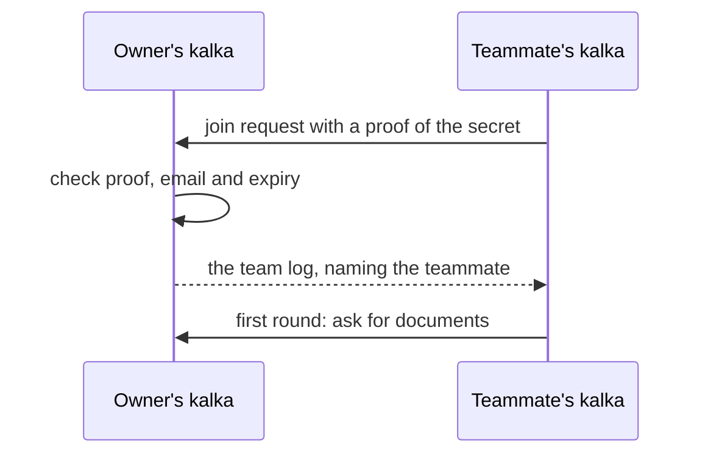

# Joining a team

How an invite link becomes a member, at the level a user sees and in kalka's code. Every code node links to the lines it describes; with `gh` signed in, each shows them beside the trace.

## Words

This plan names no domain, so it keeps its own words: kalka links them in the text and on the trace steps.

```glossary v2
term invite: A signed offer to join a team, for one email address, until it expires
  form invites

term joiner: The person an invite was sent to, from opening it until they are a member
  alias newcomer

term team log: The signed record of a team's members and owners, which every member holds
```

## From invite to member



The trace below follows the same path, with the business steps on the left and the code on the right. K3 loops back to itself while the owner is offline, and K4 carries a key of the author's own (`x-threat-model`), which kalka ignores without a warning.

```trace v2
lane business

step J1: The owner invites a teammate by email
  next J2
step J2: The teammate opens the link
  next J3
step J3: The owner's kalka checks it is the invited person
  next J4
step J4: The teammate becomes a member
  next J5
step J5: The teammate gets the team's documents

lane code

step K1: Sign an invite with a secret and an expiry
  next K2
  realizes J1
  ref gh:internal/core/teams.go#L350-L386
step K2: Parse the link and queue the join
  next K3
  realizes J2
  ref gh:internal/core/join.go#L152-L186
step K3: Retry until the owner is online
  next K4
  back K3: owner offline, until the invite expires
  realizes J2
  ref gh:internal/core/join.go#L233-L294
  why the owner may be offline when the link is opened
step K4: Prove the secret without sending it
  next K5
  ref gh:internal/teamlog/invite.go#L152-L156
  why a recorded session cannot be replayed to join again
  x-threat-model section 21
step K5: Check proof, email and expiry; add the member to the log
  next K6
  realizes J3
  realizes J4
  ref gh:internal/core/join.go#L492-L565
step K6: Keep the log only if it names the joiner
  realizes J5
  ref gh:internal/core/join.go#L396-L437
  why the first round needs the log before it can ask for documents
```

## When the invite is refused

```trace v2
lane business

step R1: The teammate opens a link that no longer works
  next R2: expired or used
step R2: The teammate is told why and asks for a new link

lane protocol

step P1: bye with a reason: invite-expired, invite-used, invite-email
  next P2
  realizes R1
step P2: The join stays listed as failed, with the reason
  realizes R2

lane code

step X1: admit answers with the reason
  next X2
  realizes P1
  ref gh:internal/core/join.go#L520-L528
step X2: Record the failure and notify
  realizes P2
  ref gh:internal/core/join.go#L268-L291
```

## Reading the divergences

kalka computes them from the graph; nothing above declares them.

- **Expanded**: J2 is realized by K2 and K3, since a join may wait for the owner.
- **Implementation-only**: K4 realizes nothing a user sees; its `why` says what it protects.
- **Merged**: K5 checks the person and adds them in one step.
- The second block has none: each step of each lane is carried out by exactly one step of the lane below.
