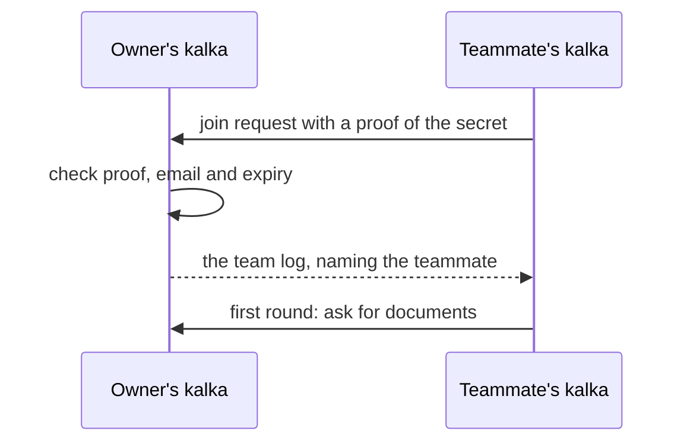

# Joining a team

How an invite link becomes a member, at the level a user sees and in kalka's code. Every code node links to the lines it describes; with `gh` signed in, each shows them beside the trace.

## From invite to member



The trace below follows the same path, with the business steps on the left and the code on the right. K3 loops back to itself while the owner is offline, and K4 carries a key of the author's own (`x-threat-model`), which kalka ignores without a warning.

```trace v1
lanes: [business, code]
nodes:
  - id: J1
    lane: business
    text: "The owner invites a teammate by email"
    next: [J2]
  - id: J2
    lane: business
    text: "The teammate opens the link"
    next: [J3]
  - id: J3
    lane: business
    text: "The owner's kalka checks it is the invited person"
    next: [J4]
  - id: J4
    lane: business
    text: "The teammate becomes a member"
    next: [J5]
  - id: J5
    lane: business
    text: "The teammate gets the team's documents"

  - id: K1
    lane: code
    text: "Sign an invite with a secret and an expiry"
    realizes: [J1]
    ref: "gh:internal/core/teams.go#L350-L386"
    next: [K2]
  - id: K2
    lane: code
    text: "Parse the link and queue the join"
    realizes: [J2]
    ref: "gh:internal/core/join.go#L152-L186"
    next: [K3]
  - id: K3
    lane: code
    text: "Retry until the owner is online"
    realizes: [J2]
    ref: "gh:internal/core/join.go#L233-L294"
    why: "the owner may be offline when the link is opened"
    back:
      K3: "owner offline, until the invite expires"
    next: [K4]
  - id: K4
    lane: code
    text: "Prove the secret without sending it"
    ref: "gh:internal/teamlog/invite.go#L152-L156"
    why: "a recorded session cannot be replayed to join again"
    x-threat-model: "section 21"
    next: [K5]
  - id: K5
    lane: code
    text: "Check proof, email and expiry; add the member to the log"
    realizes: [J3, J4]
    ref: "gh:internal/core/join.go#L492-L565"
    next: [K6]
  - id: K6
    lane: code
    text: "Keep the log only if it names the joiner"
    realizes: [J5]
    ref: "gh:internal/core/join.go#L396-L437"
    why: "the first round needs the log before it can ask for documents"
```

## When the invite is refused

```trace v1
lanes: [business, protocol, code]
nodes:
  - id: R1
    lane: business
    text: "The teammate opens a link that no longer works"
    next:
      R2: "expired or used"
  - id: R2
    lane: business
    text: "The teammate is told why and asks for a new link"

  - id: P1
    lane: protocol
    text: "bye with a reason: invite-expired, invite-used, invite-email"
    realizes: [R1]
    next: [P2]
  - id: P2
    lane: protocol
    text: "The join stays listed as failed, with the reason"
    realizes: [R2]

  - id: X1
    lane: code
    text: "admit answers with the reason"
    realizes: [P1]
    ref: "gh:internal/core/join.go#L520-L528"
    next: [X2]
  - id: X2
    lane: code
    text: "Record the failure and notify"
    realizes: [P2]
    ref: "gh:internal/core/join.go#L268-L291"
```

## Reading the divergences

kalka computes them from the graph; nothing above declares them.

- **Expanded**: J2 is realized by K2 and K3, since a join may wait for the owner.
- **Implementation-only**: K4 realizes nothing a user sees; its `why` says what it protects.
- **Merged**: K5 checks the person and adds them in one step.
- The second block has none: each step of each lane is carried out by exactly one step of the lane below.
