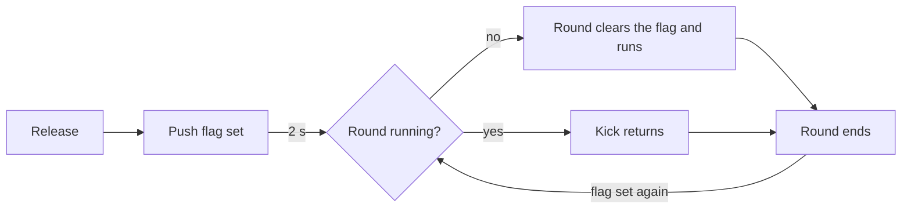

# A push during a round is not lost

## Context

Releasing a version asks for a push: a round of the team two seconds later, so that teammates who are online get it at once. A round of a team that is already running is skipped, so two rounds never fetch the same documents twice. A push that arrived while a round ran was therefore dropped. The release still went out with the next periodic round, up to ten minutes later, and a reviewer waiting for it saw nothing.

## Scope

Touches the replication loop in `internal/core/replicate.go`: [pushTeam](gh:internal/core/replicate.go#L845-L850), [round](gh:internal/core/replicate.go#L942-L955) and the end of a round.

Does not change what a round sends, how many members it reaches, or the periodic round.

## Plan

1. A push sets the team's push flag and kicks a round after `PushDelay`, as today.
2. A round that starts clears the flag; a kick that finds a round running returns, as today.
3. A new `endRound` runs when a round finishes: if the flag was set again meanwhile, it kicks another round.
4. A daemon that is stopping or paused starts no new round; a paused one keeps the flag for its resume.



### The push path

```trace v1
lanes: [business, code]
nodes:
  - id: B1
    lane: business
    text: "The owner releases a version"
    next: [B2]
  - id: B2
    lane: business
    text: "Online teammates get it within seconds"
    next: [B3]
  - id: B3
    lane: business
    text: "A release during a sync is not held back"

  - id: C1
    lane: code
    text: "Set the push flag and kick after PushDelay"
    realizes: [B1]
    ref: "gh:internal/core/replicate.go#L845-L850"
    next: [C2]
  - id: C2
    lane: code
    text: "One round per team at a time; it clears the flag as it starts"
    realizes: [B2]
    ref: "gh:internal/core/replicate.go#L942-L955"
    why: "two rounds of one team would fetch the same documents twice"
    next: [C3]
  - id: C3
    lane: code
    text: "When a round ends, kick again if the flag was set"
    realizes: [B3]
    ref: "gh:internal/core/replicate.go#L930-L939"
    next: [C4]
  - id: C4
    lane: code
    text: "No new round once the daemon is stopping"
    ref: "gh:internal/core/replicate.go#L936-L938"
    why: "shutdown waits for running rounds, so a new one would delay it"
```

## Verification plan

- [TestPushDuringRound](gh:internal/core/replicate_test.go#L539-L589): a release made while a round runs reaches the teammate before the next periodic round could.
- Two quick releases in a row cause at most two rounds, not one per kick.
- Stopping the daemon during a round ends it within the drain timeout, with no round started after.
- Reviewer: run two daemons with `KALKA_TEST_LOG=1`, release during a slow round, and read the order of "round" lines.

## Critical sections

The push flag is cleared when a round **starts**, never when it ends. A push that arrives during a round sets it again, and that is what `endRound` sees. Clearing it in `endRound` would look tidier and would bring the lost push back. Both reads and writes of the flag happen under `repl.mu`.

## Operations

- Failure: a push is still lost somewhere. The periodic round every ten minutes delivers it; the Team page's *Sync now* does at once. The log shows "published … as version N" with no round after it.
- Rollback: revert the change. Nothing is stored, so there is nothing to migrate.
