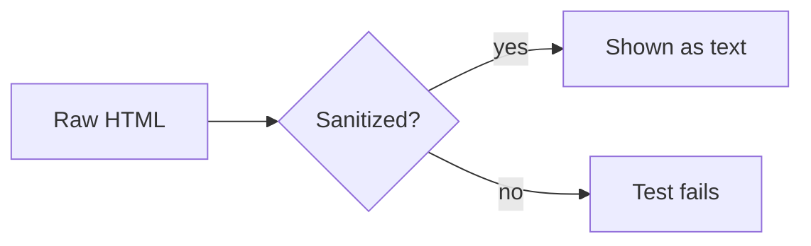

# Render untrusted plans safely

A plan from a teammate is untrusted input shown in a page that can write files and start syncs. This document is a manual test: open it in the review view and compare what you see with what each section says. It carries on purpose the Markdown that must be refused, and the Markdown that must come out right.

## Raw HTML

The next paragraph holds raw HTML. It must show as plain text or not at all, and no alert may appear.

<script>alert("raw script ran")</script>

<a href="javascript:alert('raw link ran')">a raw link</a>

## Links

- [A web link](https://example.org/docs) opens as a link.
- [A script link](javascript:alert('link ran')) must not be a link.
- [A plugin reference with no plugin](wiki:onboarding) shows its label as plain text.
- [A reference the `gh` plugin reads](gh:internal/core/replicate.go#L942-L955) shows its lines when `gh` is signed in, and its label otherwise.

## Glossary linking

Terms of the sync domain are underlined in text: a blueprint, its entries, each release, a round that a push asks for.

- A term broken across lines still matches: the team
  log is replayed by every member.
- A term interrupted by markup does not: the ro*und* is not underlined.
- Code is never linked: `round`, `push`, and the alias `sync cycle`.
- Link text is matched, so is [every round](https://example.org/rounds), and a link's target never is.
- A longer term wins over a shorter: a "team log" is one match, not "team" and "log".

```text
a round of the sync cycle, in a code block: nothing here is linked or checked
```

## Tables and lists

| Case | Expected |
|---|---|
| A cell with a round | the term is underlined |
| A cell with `code` | monospace, no link |

- [x] A finished item
- [ ] An open item

## Diagrams



## Anchors

Headings give the anchors that comments attach to. A repeated heading gets a suffix, and a heading with non-ASCII letters keeps them.

### Case

First heading with this title: the anchor is `case`.

### Case

Second heading with this title: the anchor is `case-1`.

### Kolejka w Łodzi

The anchor is `kolejka-w-łodzi`: letters are kept, spaces become hyphens.
